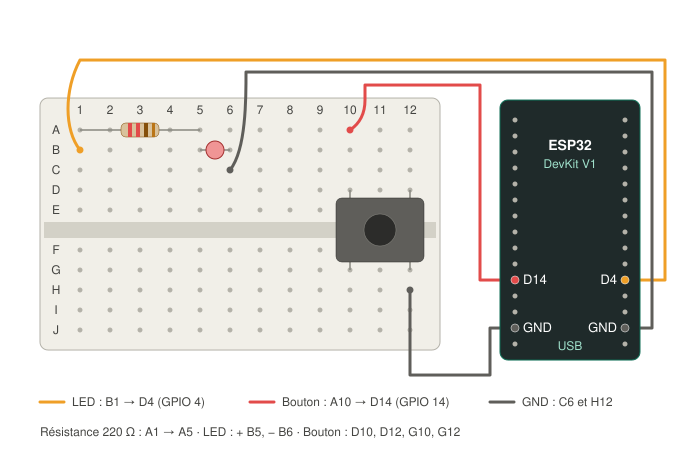

# Expérience n°02 — Bouton poussoir + LED externe (sur breadboard)

> **But** : apprendre la breadboard, brancher une LED externe, et surtout lire une ENTRÉE (un bouton). C'est le complément logique de l'exp. 01, qui ne faisait que des sorties.
> **Résultat attendu** : tant qu'on maintient le bouton appuyé, la LED externe s'allume (luminosité réduite), avec un message dans le terminal.
> **Statut** : ✅ validée le 08/11/2026.

Les notions de fond (boucle de courant, GND, breadboard, INPUT_PULLUP, PWM) sont expliquées dans [VEILLE.md](../VEILLE.md).

## Matériel

- 1 × LED (n'importe quelle couleur)
- 1 × résistance **220 Ω** (bandes rouge-rouge-brun), qui protège la LED
- 1 × bouton poussoir 4 pattes
- 4 × fils de jumper **mâle-femelle** : le côté mâle (une broche) se plante dans la breadboard, le côté femelle (un trou) s'enfile sur une broche de l'ESP32
- la breadboard du kit

## Câblage



### Sur la breadboard

| Composant | Trous |
|---|---|
| Résistance 220 Ω | A1 → A5 |
| LED | **+ (patte longue) en B5**, − en B6 |
| Bouton (à cheval sur le creux) | D10, D12, G10, G12 |

### Fils vers l'ESP32

| Fil | Breadboard | ESP32 |
|---|---|---|
| Signal LED | B1 | **D4** (GPIO 4) |
| GND LED | C6 | GND (côté D4) |
| Signal bouton (rouge) | A10 | **D14** (GPIO 14) |
| GND bouton | H12 | GND (côté D14) |

### Le trajet du courant

```
LED    : D4  → B1 ═ A1 → résistance → A5 ═ B5 → LED → B6 ═ C6 → GND
Bouton : D14 → A10 ═ D10 → [appui] → G12 ═ H12 → GND
```

`═` : liaison cachée dans la breadboard (même rangée). `→` : composant ou fil.

⚠️ **Bouton** : il se pose **à cheval sur le creux central**, et ses deux fils vont **en diagonale** (rangée 10 d'un côté, rangée 12 de l'autre). Si les deux fils sont sur la même rangée, le bouton les relie en permanence et paraît « toujours appuyé ».

## Le code en bref

```cpp
static const int LED_PIN    = 4;   // doit correspondre au fil de la LED
static const int BTN_PIN    = 14;  // doit correspondre au fil du bouton
static const int LUMINOSITE = 40;  // 0 (éteinte) à 255 (pleine puissance)
```

- `pinMode(BTN_PIN, INPUT_PULLUP)` : la broche du bouton lit **HIGH au repos, LOW à l'appui**.
- `analogWrite(LED_PIN, …)` : allume la LED à luminosité réduite (PWM). Pour la régler, changer `LUMINOSITE` et reflasher.

## Le concept à retenir : INPUT_PULLUP

Une broche reliée à rien est **flottante** : elle prend une valeur au hasard (on lit du bruit). Deux solutions pour lui donner un état de repos :

1. une résistance externe (l'ancienne méthode) ;
2. **INPUT_PULLUP** : la puce ESP32 contient déjà une résistance qui tire la broche vers 3,3 V. L'appui relie simplement la broche à GND.

Conséquence contre-intuitive : **relâché = HIGH, appuyé = LOW**. C'est la norme dans l'industrie, on la reverra partout (fins de course, capteurs…).

## Commandes (depuis CE dossier)

```sh
pio run            # compiler
pio run -t upload  # flasher
pio device monitor # voir les messages (Ctrl+C pour sortir)
```

Au repos, le moniteur affiche toutes les 2 s :

```
etat bouton = REPOS   | LED = 0 | temps = 8 s
```

À l'appui : `appui  -> LED allumee`, puis `relache -> LED eteinte` au relâchement.

## Dépannage (vécu)

| Symptôme | Cause | Correction |
|---|---|---|
| Rien ne se passe à l'appui | Les broches du code ne correspondent pas aux fils (le code disait 23 et 4, les fils étaient sur 4 et 14) | Aligner `LED_PIN` / `BTN_PIN` sur le câblage |
| Le moniteur affiche `APPUI` sans toucher au bouton | Les deux fils du bouton sont sur la même rangée | Mettre les fils en diagonale |
| LED faiblement allumée en permanence | La broche de la LED est réglée en entrée `INPUT_PULLUP` : un petit courant passe | Vérifier que `LED_PIN` est bien la broche de la LED |
| LED jamais allumée | LED montée à l'envers (patte longue côté GND), ou boucle non fermée (fil GND manquant) | Retourner la LED, vérifier le fil vers GND |
| Messages d'appui en rafale | Rebonds du contact du bouton | Augmenter le `delay` d'anti-rebond |

Premier réflexe : **ouvrir le moniteur série** pour voir ce que la carte lit vraiment.

## Pour aller plus loin

1. **Toggle** (→ expérience 03) : un appui allume, l'appui suivant éteint (mémoriser un état et gérer l'anti-rebond).
2. Un bouton qui commande la LED onboard (GPIO 2) en même temps que la LED externe.
3. Deux boutons : un pour allumer, l'autre pour éteindre.
