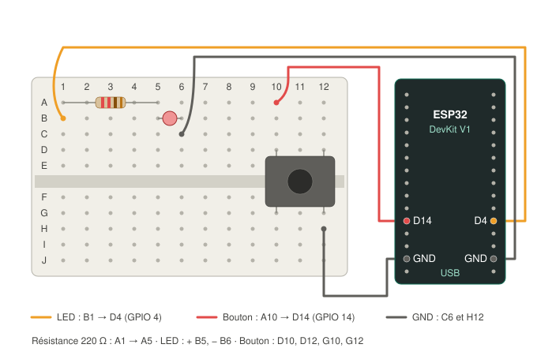

# Expérience n°03 — Toggle : un appui allume, le suivant éteint

> **But** : apprendre à **mémoriser un état** et à **filtrer les rebonds** d'un bouton.
> **Résultat attendu** : un appui allume la LED, qui reste allumée après le relâchement. L'appui suivant l'éteint. Chaque appui est compté dans le terminal.
> **Statut** : ✅ validée le 08/11/2026 (12 appuis, 2 rebonds filtrés).

Les notions de fond sont expliquées dans [VEILLE.md](../VEILLE.md).

## Matériel et câblage

**Identiques à l'expérience 02**, rien à débrancher : seul le code change.



| Fil | Breadboard | ESP32 |
|---|---|---|
| Signal LED | B1 | **D4** (GPIO 4) |
| GND LED | C6 | GND (côté D4) |
| Signal bouton (rouge) | A10 | **D14** (GPIO 14) |
| GND bouton | H12 | GND (côté D14) |

Résistance 220 Ω en A1 → A5, LED + en B5 et − en B6, bouton en D10, D12, G10 et G12.

## Ce qui change par rapport à l'expérience 02

| Expérience 02 | Expérience 03 |
|---|---|
| La LED **recopie** le bouton : appuyé = allumée, relâché = éteinte | La LED **change d'état** à chaque appui, et le garde |
| Pas de mémoire | Une variable `ledAllumee` se souvient de l'état |
| On regarde l'**état** du bouton (appuyé ou pas) | On guette le **moment** où il passe de relâché à appuyé |
| Les rebonds ne se voyaient pas | Les rebonds feraient clignoter la LED au hasard : il faut les filtrer |

## Notion 1 : mémoriser un état

```cpp
bool ledAllumee = false;      // au démarrage, la LED est éteinte
...
ledAllumee = !ledAllumee;     // « ! » veut dire « l'inverse de »
```

À chaque appui, on inverse la variable, puis on allume ou éteint la LED selon sa valeur.

## Notion 2 : détecter le front (le moment de l'appui)

Si on inversait la LED **tant que** le bouton est appuyé, elle clignoterait des centaines de fois par seconde. On ne réagit donc qu'au **changement** HIGH → LOW, c'est-à-dire à l'instant où on enfonce le bouton. C'est ce qu'on appelle détecter un **front**. Le relâchement (LOW → HIGH) est ignoré.

## Notion 3 : l'anti-rebond

Un bouton mécanique ne fait pas un contact net. Pendant quelques millisecondes, ses lamelles **rebondissent** : contact, pas contact, contact… Pour l'ESP32, qui lit des milliers de fois par seconde, un seul appui peut ressembler à 3 ou 4 appuis.

La solution du code : **on ne croit le bouton que s'il n'a pas bougé pendant 50 ms.**

```
lecture brute :  HIGH ─┐ ┌┐ ┌──────────────── LOW (appuyé)
                       └─┘└─┘
                       ←rebonds→←── stable 50 ms ──→ appui accepté
```

Le réglage est dans `ANTI_REBOND_MS`. Trop court, les rebonds passent. Trop long, le bouton paraît lent à réagir.

## Commandes (depuis CE dossier)

```sh
pio run            # compiler
pio run -t upload  # flasher
pio device monitor # voir les messages (Ctrl+C pour sortir)
```

Exemple de ce qu'affiche le moniteur :

```
appui n°1 -> LED allumee   (changements bruts vus depuis le debut : 1)
appui n°2 -> LED eteinte   (changements bruts vus depuis le debut : 4)
```

Les « changements bruts » comptent **tout** ce que la broche a vu, rebonds et relâchements compris. S'il y en a nettement plus que 2 par appui (un pour l'appui, un pour le relâchement), ce sont des rebonds que le code a filtrés.

## Dépannage

| Symptôme | Cause probable |
|---|---|
| Un appui change parfois la LED deux fois (elle ne bouge pas, ou clignote) | Rebonds plus longs que 50 ms : augmenter `ANTI_REBOND_MS` (par ex. 80) |
| Rien ne se passe | Câblage modifié depuis l'exp. 02 : comparer avec le schéma |
| La LED change d'état au relâchement plutôt qu'à l'appui | Test `etatStable == LOW` remplacé par `HIGH` dans le code |

## Pour aller plus loin

1. **Appui long** : un appui de plus d'une seconde éteint toujours la LED, quel que soit son état.
2. **Plusieurs niveaux** : chaque appui fait passer la luminosité à l'étape suivante (éteint → faible → moyen → fort → éteint).
3. **Mémoire après coupure** : retrouver l'état de la LED après un redémarrage (stockage dans la mémoire flash, bibliothèque `Preferences`).
